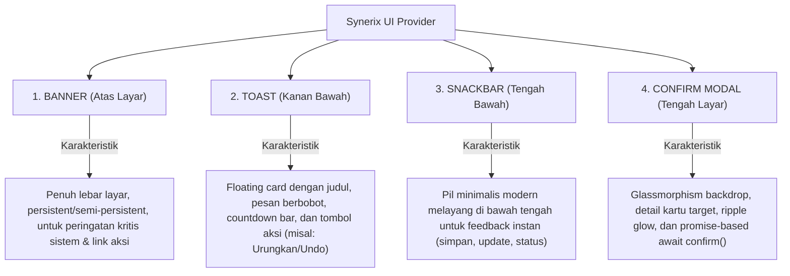

---
design_system:
  name: "Synerix FTTH Design System (Inspirasi Dashboard Asterix)"
  version: "1.0.0"
  framework: "Tailwind CSS v4 (@theme directive)"
  theme_mode: "Clean Light Enterprise Theme (with Slate-900 High-Contrast Accents)"
  color_tokens:
    primary:
      deep_teal: "#0F766E"      # --color-synerix-primary (Asterix Deep Teal)
      bright_teal: "#14B8A6"    # --color-synerix-teal (Aksen Utama & Focus Ring)
      emerald_lime: "#10B981"   # --color-synerix-lime (Status Sukses & Aktif)
      cyan_blue: "#06B6D4"      # --color-synerix-cyan (Gradasi & Highlight)
      amber_yellow: "#F59E0B"   # --color-synerix-amber (Peringatan & Maintenance)
    surfaces:
      background: "#F8FAFC"     # --color-synerix-bg (Soft Grayish Light Canvas)
      card: "#FFFFFF"           # --color-synerix-card (Pure White Elevated Card)
      border: "#E2E8F0"         # --color-synerix-border (Subtle Slate Border)
      border_dark: "#334155"    # Dark accent border
    typography:
      text_main: "#0F172A"      # --color-synerix-text (Slate-900 Dark Navy Main Text)
      text_subtext: "#64748B"   # --color-synerix-subtext (Slate-500 Muted Text)
      text_muted: "#94A3B8"     # Slate-400 Placeholder & Subtle Text
    status:
      success:
        bg: "bg-emerald-50"
        border: "border-emerald-200"
        text: "text-emerald-800"
        dot: "bg-emerald-500"
      danger:
        bg: "bg-rose-50"
        border: "border-rose-200"
        text: "text-rose-800"
        dot: "bg-rose-500"
      warning:
        bg: "bg-amber-50"
        border: "border-amber-200"
        text: "text-amber-800"
        dot: "bg-amber-500"
      info:
        bg: "bg-teal-50"
        border: "border-teal-200"
        text: "text-teal-800"
        dot: "bg-teal-500"
      neutral:
        bg: "bg-slate-100"
        border: "border-slate-200"
        text: "text-slate-600"
        dot: "bg-slate-400"
  branding:
    logos:
      asterix: "/images/logo-asterix.png"
      fibermaxs: "/images/logo-fibermaxs.png"
      digimaxs: "/images/logo-digimaxs.png"
      synerix: "/images/logo-synerix.png"
      icon: "/images/icon-synerix.png"
    signature_gradient: "bg-gradient-to-r from-teal-500 via-emerald-400 to-cyan-500"
---

# 🎨 Synerix FTTH Design System

Dokumen ini merupakan pedoman resmi dan rangkuman arsitektur antarmuka pengguna (**UI/UX Design System**) untuk platform **Synerix FTTH - Network Operations Platform**.

Sistem desain ini dibangun di atas **Tailwind CSS v4** dengan filosofi **"Asterix Clean Light Theme"**: mengedepankan keterbacaan tinggi untuk personil lapangan dan tim NOC, antarmuka yang presisi, palet warna korporat yang harmonis (Deep Teal, Emerald, dan Slate Navy), serta pola interaksi yang konsisten di seluruh modul.

---

## 1. Fondasi Tema & Konfigurasi CSS (Tailwind v4)

Sistem styling didefinisikan secara deklaratif di `src/app/globals.css` menggunakan sintaks baru Tailwind v4 `@theme`:

```css
@import "tailwindcss";

@theme {
  --color-synerix-bg: #F8FAFC;      /* Background Halaman Bersih */
  --color-synerix-card: #FFFFFF;    /* Permukaan Kartu / Kontainer */
  --color-synerix-border: #E2E8F0;  /* Garis Border Halus */
  --color-synerix-primary: #0F766E; /* Asterix Deep Teal */
  --color-synerix-teal: #14B8A6;    /* Bright Teal Accent */
  --color-synerix-lime: #10B981;    /* Green Emerald */
  --color-synerix-amber: #F59E0B;   /* Amber Yellow */
  --color-synerix-cyan: #06B6D4;    /* Cyan Blue */
  --color-synerix-text: #0F172A;    /* Slate-900 Main Text */
  --color-synerix-subtext: #64748B; /* Slate-500 Subtext */
}
```

### Garis Aksen Khas (Signature Decorative Bar)
Setiap komponen kunci (Top Header, Modal Dialog, Card Login, Drawer) wajib memiliki garis aksen atas dengan gradasi 3 warna:
```html
<div className="h-1.5 w-full bg-gradient-to-r from-teal-500 via-emerald-400 to-cyan-500" />
```

---

## 2. Tipografi & Hierarki Teks

Font dasar menggunakan tatanan sans-serif bawaan modern: `system-ui, -apple-system, BlinkMacSystemFont, 'Segoe UI', Roboto, sans-serif`. Kode monospaced (`font-mono`) digunakan untuk seluruh identifikasi teknis seperti ID Tiket, ID Pelanggan, koordinat GIS, dan port fiber.

| Level Hierarki | Ukuran Tailwind | Berat Huruf | Warna | Kegunaan |
|---|---|---|---|---|
| **Page Title** | `text-xl sm:text-2xl` | `font-bold` / `font-extrabold` | `text-slate-900` | Judul utama halaman |
| **Section Header** | `text-base sm:text-lg` | `font-bold` | `text-slate-900` | Header modal, tabel, atau kartu ringkasan |
| **Card / Item Title** | `text-xs sm:text-sm` | `font-bold` | `text-slate-900` / `text-slate-800` | Nama pelanggan, judul log, nomor node |
| **Body / Input Text** | `text-xs sm:text-sm` | `font-medium` | `text-slate-700` | Teks isi, formulir input, keterangan |
| **Subtitle / Meta** | `text-xs` / `text-[11px]` | `font-normal` / `font-medium` | `text-slate-500` / `text-slate-400` | Keterangan pembantu, petunjuk input |
| **Technical Badges** | `text-[10px]` / `text-[9px]` | `font-bold font-mono` | Menyesuaikan status | ID Tiket `#123`, role, status aktif |

---

## 3. Sistem Layouting & Arsitektur Tata Letak (Layout Architecture)

Tata letak halaman di Synerix FTTH dirancang responsif, fleksibel, dan terstandarisasi untuk kenyamanan teknisi di lapangan (layar smartphone/tablet) maupun operator NOC di kantor (desktop/monitor besar):

### A. Kontainer & Batas Lebar (Container Hierarchy)
* **Standard Dashboard Container**:
  Digunakan pada `/work-logs`, `/dismantles`, `/admin/users`, `/shifts`, dan `/overtime`:
  ```tsx
  <div className="w-full min-h-screen bg-slate-50/50 pb-16">
    {/* Page Sub-Header Strip */}
    <div className="bg-white border-b border-slate-200">
      <div className="max-w-7xl mx-auto px-4 sm:px-6 lg:px-8 py-6">...</div>
    </div>
    {/* Main Content Area */}
    <div className="max-w-7xl mx-auto px-4 sm:px-6 lg:px-8 mt-6">...</div>
  </div>
  ```
* **Full-Canvas Map Container (`/mapping`)**:
  Memanfaatkan 100% viewport layar tanpa margin untuk interaksi peta GIS Leaflet maksimal:
  ```tsx
  <div className="w-full h-[calc(100vh-56px)] sm:h-[calc(100vh-64px)] relative overflow-hidden flex flex-col">
    {/* Interactive GIS Map Fullscreen */}
  </div>
  ```
* **Centered Card Canvas (`/login`)**:
  Kanvas terpusat dengan efek ambient background glow:
  ```tsx
  <div className="min-h-screen w-full flex items-center justify-center p-4 sm:p-6 lg:p-8 bg-[#F8FAFC]">
    <div className="w-full max-w-md relative z-10">...</div>
  </div>
  ```

### B. Pola Header Bertingkat (Two-Tier Header Pattern)
1. **Tier 1 (Sticky Global Topbar)**:
   * Posisi `sticky top-0 z-50` dengan `bg-white/95 backdrop-blur-md border-b`.
   * Menampung barisan logo partner resmi, menu navigasi horizontal desktop, pill status teknisi dengan pulsing dot, dan dropdown avatar pengguna.
2. **Tier 2 (Module Hero / Action Strip)**:
   * Menampung icon badge modul, judul halaman, deskripsi operasional, tombol aksi primer di sebelah kanan (misal: *Tambah Pekerjaan* atau *Tambah Teknisi Baru*), serta 4-kolom ringkasan metrik statistik.

### C. Pola Tampilan Data Ganda (Dual-View: Card Grid vs Table)
Pengguna dapat berganti antara tampilan kartu visual atau tabel padat:
* **Grid Mode (Responsif)**:
  `grid grid-cols-1 md:grid-cols-2 xl:grid-cols-3 gap-3 sm:gap-4`
  Setiap kartu dilengkapi garis aksen vertikal kiri (`border-l-[6px]`) penanda status atau kategori tiket.
* **Table Mode (Enterprise Data)**:
  `overflow-x-auto bg-white rounded-2xl border border-slate-200 shadow-2xs`
  Baris tabel memiliki transisi hover `hover:bg-slate-50/60`, kolom identitas sticky/kontras, dan aksi baris di sebelah kanan (`text-right`).

### D. Navigasi Mobile & Breakpoints
* **Desktop (`≥ 768px`)**:
  Navigasi teks lengkap di Topbar atas dengan dropdown profil pengguna.
* **Mobile Phone (`< 768px`)**:
  * Topbar atas dipadatkan (hanya menampilkan logo dan tombol avatar).
  * **Bottom Navigation Bar** muncul di bawah layar (`fixed bottom-0 left-0 right-0 z-40 bg-white/95 backdrop-blur-md border-t border-slate-200 py-2 flex justify-around`):
    * Tab 1: *Overview*
    * Tab 2: *Pekerjaan*
    * Tab 3: *Mapping*
    * Tab 4: *Dismantle*
  * Menu lengkap lainnya diakses melalui Slide-Over Drawer.

### E. Pola Modal & Drawer
* **Centered Modal**:
  `fixed inset-0 z-50 flex items-center justify-center p-4 bg-slate-950/60 backdrop-blur-sm` dengan kontainer `w-full max-w-lg bg-white rounded-3xl shadow-2xl overflow-hidden`.
  Body modal memiliki pembatas tinggi `max-h-[85vh]` dan scrollbar tersembunyi `[scrollbar-width:none]`.
* **Side Drawer (GIS Layer Manager)**:
  `fixed inset-y-0 right-0 z-50 w-full sm:w-96 bg-white shadow-2xl flex flex-col` untuk manajemen layer peta tanpa meninggalkan konteks visual.

---

## 4. Spacing, Border Radius & Elevation (Shadows)

### A. Border Radius
* **`rounded-3xl` (24px)**: Digunakan untuk kontainer utama modal dialog (`EnterpriseConfirmModal`, Modal Form) dan Card Login.
* **`rounded-2xl` (16px)**: Digunakan untuk kartu ringkasan metrik, kontainer toolbar/pencarian, dan tabel data wrapper.
* **`rounded-xl` (12px)**: Digunakan untuk input form, tombol utama/sekunder, dropdown select, dan badge grup.
* **`rounded-lg` (8px)**: Digunakan untuk item kecil di dalam list, tombol aksi ikon (`p-2`), dan tag filter.
* **`rounded-full` (9999px)**: Digunakan untuk indikator status (pill status), avatar inisial, dan pin GIS.

### B. Shadows & Elevation
* **Card Biasa**: `shadow-2xs` atau `shadow-xs` dengan `border border-slate-200/90` (flat, clean, tidak berat).
* **Hover State Card**: `hover:shadow-sm hover:border-slate-300 transition-all`.
* **Elevated Modal & Dropdown**: `shadow-2xl` atau `shadow-xl` dengan `backdrop-blur-sm` atau `backdrop-blur-md`.
* **Brand Button Elevation**: `shadow-md shadow-teal-600/20` untuk tombol aksi utama.

---

## 5. Logo & Komposisi Brand Partner

Aplikasi Synerix FTTH merupakan platform kolaboratif multi-operator lapangan. Pada bagian **Topbar** dan **Login Form**, logo selalu ditampilkan berdampingan dalam satu kesatuan bar:

```tsx
<div className="flex items-center gap-2.5 sm:gap-3 py-1.5 px-3 rounded-2xl bg-white border border-slate-200 shadow-2xs">
  {/* 1. Asterix Inovasi Teknologi */}
  <Image src="/images/logo-asterix.png" alt="Asterix" width={80} height={20} className="h-4 sm:h-5 w-auto object-contain" />
  <div className="h-3.5 w-[1px] bg-slate-200" />
  
  {/* 2. Fibermaxs Partner */}
  <Image src="/images/logo-fibermaxs.png" alt="Fibermaxs" width={75} height={18} className="h-3.5 sm:h-4 w-auto object-contain" />
  <div className="h-3.5 w-[1px] bg-slate-200" />
  
  {/* 3. Digimaxs Partner */}
  <Image src="/images/logo-digimaxs.png" alt="Digimaxs" width={75} height={18} className="h-3.5 sm:h-4 w-auto object-contain" />
</div>
```

---

## 6. Pola Komponen Utama (Core UI Patterns)

### 6.1. Topbar Navigation & Profil Pengguna (`src/components/layout/Topbar.tsx`)
* **Latar**: `bg-white/95 backdrop-blur-md border-b border-synerix-border sticky top-0 z-50`.
* **Navigasi Aktif**: `bg-teal-50 text-teal-800 border border-teal-200/90 font-bold`.
* **Navigasi Default**: `text-slate-600 hover:text-slate-900 hover:bg-slate-50 font-semibold text-xs`.
* **Status Teknisi**: Pill `bg-slate-50 border border-slate-200 text-slate-700` dengan pulsing dot hijau (`bg-emerald-500 animate-ping`).
* **Profil Pengguna**: Avatar inisial bergradasi `from-teal-600 to-emerald-700 text-white font-bold text-xs`.

### 6.2. Kartu Ringkasan Metrik (Metric Summary Cards)
Digunakan pada dashboard atas (`/work-logs`, `/dismantles`, `/admin/users`):
```tsx
<div className="grid grid-cols-2 lg:grid-cols-4 gap-3 sm:gap-4">
  {/* Card Total */}
  <div className="p-4 rounded-2xl bg-white border border-slate-200/90 shadow-2xs">
    <p className="text-[11px] font-bold text-slate-500 uppercase tracking-wider">Total Data</p>
    <p className="text-2xl font-extrabold text-slate-900 mt-1">24</p>
  </div>
  {/* Card Aktif / Sukses */}
  <div className="p-4 rounded-2xl bg-emerald-50/60 border border-emerald-200/90 shadow-2xs">
    <p className="text-[11px] font-bold text-emerald-800 uppercase tracking-wider">Selesai / Aktif</p>
    <p className="text-2xl font-extrabold text-emerald-900 mt-1">18</p>
  </div>
  {/* Card Kontras / God Mode */}
  <div className="p-4 rounded-2xl bg-slate-900 border border-slate-800 shadow-2xs text-white">
    <p className="text-[11px] font-bold text-teal-400 uppercase tracking-wider">Superadmin</p>
    <p className="text-2xl font-extrabold text-white mt-1">1</p>
  </div>
  {/* Card Teal Operasional */}
  <div className="p-4 rounded-2xl bg-teal-50/60 border border-teal-200/90 shadow-2xs">
    <p className="text-[11px] font-bold text-teal-800 uppercase tracking-wider">Dalam Proses</p>
    <p className="text-2xl font-extrabold text-teal-950 mt-1">5</p>
  </div>
</div>
```

### 6.3. Toolbar Pencarian & Filter
```tsx
<div className="bg-white rounded-2xl border border-slate-200 p-3 sm:p-4 mb-4 flex flex-col sm:flex-row items-center justify-between gap-3 shadow-2xs">
  <div className="relative w-full sm:w-80">
    <Search className="w-4 h-4 text-slate-400 absolute left-3 top-1/2 -translate-y-1/2 pointer-events-none" />
    <input
      type="text"
      placeholder="Cari ID, Nama, atau Alamat..."
      className="w-full pl-9 pr-3 py-2 text-xs rounded-xl border border-slate-200 bg-white text-slate-900 focus:outline-hidden focus:border-teal-500 focus:ring-2 focus:ring-teal-500/20 transition-all"
    />
  </div>
</div>
```

### 6.4. Formulir Input & Tombol Aksi
* **Text Input**:
  `rounded-xl border border-slate-300 bg-slate-50/70 text-slate-900 placeholder-slate-400 text-xs sm:text-sm font-medium focus:bg-white focus:outline-hidden focus:border-teal-500 focus:ring-2 focus:ring-teal-500/20`
* **Tombol Primer (Submit / Tambah)**:
  `px-4 py-2.5 rounded-xl bg-teal-600 hover:bg-teal-700 active:scale-95 text-white font-bold text-xs shadow-md shadow-teal-600/20 transition-all flex items-center gap-2 cursor-pointer disabled:opacity-50`
* **Tombol Sekunder (Batal / Tutup)**:
  `px-4 py-2.5 rounded-xl border border-slate-200 text-slate-700 font-bold text-xs hover:bg-slate-100 active:scale-95 transition-all cursor-pointer`
* **Tombol Hapus Bahaya (Danger)**:
  `p-2 rounded-xl text-slate-400 hover:text-rose-600 hover:bg-rose-50 active:scale-95 transition-all cursor-pointer`

### 6.5. Dialog Konfirmasi Modern (`EnterpriseConfirmModal.tsx`)
Digunakan untuk mencegah aksi tidak disengaja (Hapus Pekerjaan, Hapus Teknisi, Hapus Node GIS).
* **Aturan Keras**: Dilarang menggunakan `window.confirm()` bawaan browser.
* **Fitur**: Backdrop blur 40%, header accent bar (Rose untuk danger, Amber untuk warning, Teal untuk info), chip highlight nama item yang dihapus, tombol aksi dengan spinner loading otomatis.

### 6.6. Toast Notifications (`ToastNotification.tsx`)
Digunakan untuk respon asinkronus (Sukses Simpan, Error Jaringan, Batalkan Tindakan):
* **Posisi**: Mengambang di `bottom-5 right-5 z-50` dengan `max-w-md`.
* **Struktur**: `bg-slate-900/95 backdrop-blur-md text-white rounded-2xl border border-slate-800 shadow-2xl p-4`.
* **Fitur**: Dilengkapi timer bar hitung mundur otomatis (4500ms), ikon indikator sesuai tipe, dan tombol opsi "Urungkan" (Undo).

### 6.7. Gaya Khusus Pemetaan GIS FTTH (`GisMap.tsx`)
Khusus modul peta interaktif Leaflet:
* **Cluster Marker**: Lingkaran vektor gelap semi-transparan `rgba(15, 23, 42, 0.85)` dengan border cerah teal `#14B8A6` dan efek hover scale `scale(1.12)`.
* **Smart Labels**: Tooltip modern gelap `ftth-smart-label` dengan font 10px tebal dan padding ringkas.
* **Micro-Dot Marker**: Titik perangkat yang responsif terhadap hover dengan transisi pegas (`transform: scale(1.35)`).

---

## 7. Standar Pelabelan Kode 6-Bagian (Clean Architecture)

Setiap file komponen dan route handler di proyek ini wajib memiliki struktur komentar standar agar mudah dipelihara:

```typescript
/**
 * ============================================================================
 * MODUL       : [Nama Modul]
 * FILE        : [Path File]
 * DESKRIPSI   : [Fungsi Singkat File]
 * ============================================================================
 */

// ----------------------------------------------------------------------------
// BAGIAN 1: IMPORT & DEPENDENCIES
// ----------------------------------------------------------------------------

// ----------------------------------------------------------------------------
// BAGIAN 2: DEFINISI TIPE & INTERFACE (TYPESCRIPT CONTRACT)
// ----------------------------------------------------------------------------

// ----------------------------------------------------------------------------
// BAGIAN 3: KONSTANTA & KONFIGURASI
// ----------------------------------------------------------------------------

// ----------------------------------------------------------------------------
// BAGIAN 4: LOGIKA UTAMA (CORE COMPONENT & STATE)
// ----------------------------------------------------------------------------

// ----------------------------------------------------------------------------
// BAGIAN 5: HELPER / UTILITY FUNCTIONS
// ----------------------------------------------------------------------------

// ----------------------------------------------------------------------------
// BAGIAN 6: EXPORT & PUBLIC API
// ----------------------------------------------------------------------------
```

---

## 8. Aturan Pantangan (Do's & Don'ts)

| Kategori | DILARANG (Don'ts) ❌ | DIWAJIBKAN (Do's) ✅ |
|---|---|---|
| **Dialog Konfirmasi & Notifikasi** | Menggunakan `window.confirm()`, `alert()` native browser, atau kotak dialog kaku yang membosankan. | Menggunakan `useSynerixUI()` (kombinasi Toast, Snackbar, Alert Banner) dan `SynerixConfirmModal` / `await confirm(...)`. |
| **Palet Warna** | Menggunakan warna acak yang bertabrakan (misal: ungu/violet neon tanpa tujuan). | Mengikuti palet resmi: Teal (`#0F766E`), Emerald (`#10B981`), Cyan, dan Slate. |
| **Scrollbar** | Membiarkan scrollbar tebal default browser merusak modal. | Menggunakan utility hide-scrollbar: `no-scrollbar` atau `[scrollbar-width:none]`. |
| **Tombol Interaktif** | Menggunakan tombol kaku tanpa feedback klik. | Menambahkan `active:scale-95 transition-all cursor-pointer`. |
| **Form Input Focus** | Mengabaikan focus ring bawaan browser yang biru standar. | Menggunakan `focus:outline-hidden focus:border-teal-500 focus:ring-2 focus:ring-teal-500/20`. |
| **Isolasi Tampilan** | Menampilkan menu/indikator monitoring Superadmin di akun teknisi. | Menjaga tampilan teknisi tetap bersih personal (Stealth Zero-Clutter). |

---

## 9. Sistem Notifikasi Modern Terpadu & Modal Konfirmasi

Platform Synerix FTTH meninggalkan sepenuhnya paradigma kotak dialog konvensional dan native dialog browser (`alert()`, `confirm()`). Seluruh feedback pengguna dikelola secara terpusat oleh **Synerix UI System** yang menggabungkan 3 lapis notifikasi dan 1 modal konfirmasi modern:

### A. Hierarki 3 Mode Notifikasi Terpadu



### B. Spesifikasi Visual & Gaya Tiap Varian

1. **Toast Notification (Floating Right-Bottom Stack)**
   - **Backdrop**: Dark glassmorphic (`bg-slate-900/98 backdrop-blur-xl border-slate-800`).
   - **Aksen**: Left accent line & matching progress countdown bar (Emerald untuk Success, Rose untuk Error, Amber untuk Warning, Teal untuk Info).
   - **Aksi Cepat**: Dilengkapi tombol undo/action dengan ikon `RotateCcw` dan styling pill `bg-white/10 hover:bg-white/20`.

2. **Snackbar Notification (Floating Center-Bottom Pill)**
   - **Bentuk**: Rounded pill modern (`rounded-2xl shadow-2xl`) di posisi `bottom-4 left-1/2 -translate-x-1/2`.
   - **Karakter**: Ringkas, langsung to-the-point, non-blocking, durasi 3.5 detik dengan visual progress halus.

3. **Alert Banner (Top Fixed Strip)**
   - **Posisi**: Strip paling atas halaman (`fixed top-0 left-0 right-0 z-[60]`).
   - **Indikator**: Titik pulsasi animated (`animate-pulse`) + ikon varian + link rujukan eksternal/internal.

4. **Synerix Confirm Modal (Modern Promise-based Dialog)**
   - **Backdrop**: Slate-950 dengan intensitas blur `backdrop-blur-md`.
   - **Kartu Modal**: Sudut rounded besar (`rounded-[20px]`), border tipis elegan, top gradient bar penanda level risiko.
   - **Item Card Context**: Menampilkan nama item, badge kelompok, dan meta info (misal bulan jadwal atau peran teknisi) sehingga pengguna yakin 100% sebelum mengeksekusi tindakan permanen.

### C. Panduan Penggunaan (`useSynerixUI`)

```tsx
import { useSynerixUI } from "@/components/providers/SynerixUIProvider";

export default function MyComponent() {
  const { toast, snackbar, banner, error, warning, confirm } = useSynerixUI();

  // 1. Feedback Aksi Cepat (Snackbar)
  const handleSave = () => {
    snackbar("success", "Perubahan data berhasil disimpan.");
  };

  // 2. Feedback dengan Opsi Urungkan (Toast)
  const handleDeleteWithUndo = (item) => {
    toast("success", `Tugas ${item.name} dihapus.`, {
      title: "Item Dihapus",
      actionLabel: "Urungkan",
      onAction: () => restoreItem(item),
    });
  };

  // 3. Konfirmasi Tindakan Kritis (Confirm Modal - Promise Based)
  const handleCriticalDelete = async (row) => {
    const isConfirmed = await confirm({
      title: "Hapus Personel Roster?",
      description: "Data jadwal personel ini akan dihapus secara permanen.",
      itemName: row.name,
      itemBadge: row.group,
      variant: "danger",
      confirmText: "Hapus Data",
      cancelText: "Batal",
    });

    if (isConfirmed) {
      // Eksekusi penghapusan
      snackbar("success", `Data ${row.name} berhasil dihapus.`);
    }
  };
}
```

